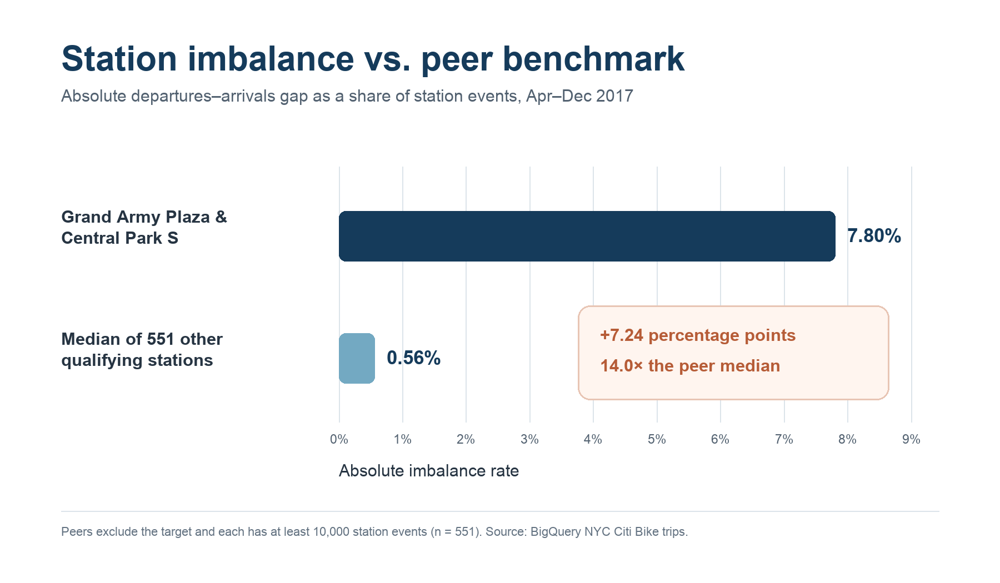

# Finding: a persistent directional imbalance at Grand Army Plaza

## The gap

For trips starting from April 1 through December 31, 2017, **Grand Army Plaza & Central Park S** recorded:

| Measure | Result |
|---|---:|
| Departures | 74,006 |
| Arrivals | 63,297 |
| Station events | 137,303 |
| Net departures | 10,709 |
| Absolute imbalance rate | 7.80% |

One analysis row represents **one Citi Bike station aggregated across the nine-month study period**. A station event is one trip endpoint: a trip creates one departure event at its start station and one arrival event at its end station. `station events` therefore means departures plus arrivals, not a count of unique trips.

The station was selected after ranking all stations with at least 10,000 station events by the absolute value of departures minus arrivals. Its positive value means more observed trips left than arrived. This is evidence of directional inventory pressure; it does not by itself prove a customer outage or reveal every operator bicycle move.

## The benchmark

The benchmark is the **median absolute imbalance rate among the other 551 stations with at least 10,000 station events**. The minimum-volume rule reduces unstable rates from lightly used stations, and the median gives a typical peer comparison without allowing a few extreme stations to dominate it.

| Comparison | Absolute imbalance rate |
|---|---:|
| Grand Army Plaza & Central Park S | 7.80% |
| Other qualifying stations, median | 0.56% |
| Difference | **7.24 percentage points** |

The target station's rate is about **14.0 times** the peer median. Applied to the target's 137,303 station events, the benchmark is about 765 absolute net events. The observed 10,709 net departures therefore exceed the benchmark by about **9,944 events**.

## Value

The monetary comparison uses contemporaneous public operating reports rather than assuming that every excess event was a lost sale.

1. April–December 2017 rider revenue: **$29,628,227**, calculated as the year-to-date rider-revenue categories in the [December 2017 operating report](https://d21xlh2maitm24.cloudfront.net/nyc/December-2017-Citi-Bike-Monthly-Report.pdf?mtime=20180216162543) minus the same categories in the [March 2017 operating report](https://d21xlh2maitm24.cloudfront.net/nyc/March-2017-Citi-Bike-Monthly-Report.pdf?mtime=20170531110546). Sponsorship, taxes, and other revenue are excluded.
2. April–December 2017 trips: **14,161,293**, the Q2, Q3, and Q4 total in NYC's [Bike Share Usage Data Report](https://a860-gpp.nyc.gov/downloads/s1784q72z?locale=en).
3. Revenue per completed trip: **$29,628,227 / 14,161,293 = $2.0922**.
4. Revenue-equivalent scale: **9,943.51 excess events × $2.0922 = $20,803.80**, or about **$20,800**.

This is the **completed-ride revenue equivalent of the excess one-way flow**. It is not an estimate of actual lost revenue, profit, or rebalancing expense. Estimating those outcomes would require station inventory, capacity, outage duration, blocked-trip demand, and operator move records.

## Chart

## Data-quality notes and limits

- The analysis uses a trip's start time to place it in scope. Trips that started by December 31 remain included even when their stop time crossed into 2018.
- The independent archive check found 49 rows where local wall-clock stop time is earlier than start time during the November 5 daylight-saving fallback hour. Each has a positive reported duration, so the rows remain.
- Station names can vary for the same ID. Queries select the most frequently observed name for display and aggregate by station ID.
- A station's exact net operator moves also depend on its starting and ending inventory. The trip table does not contain those snapshots.

